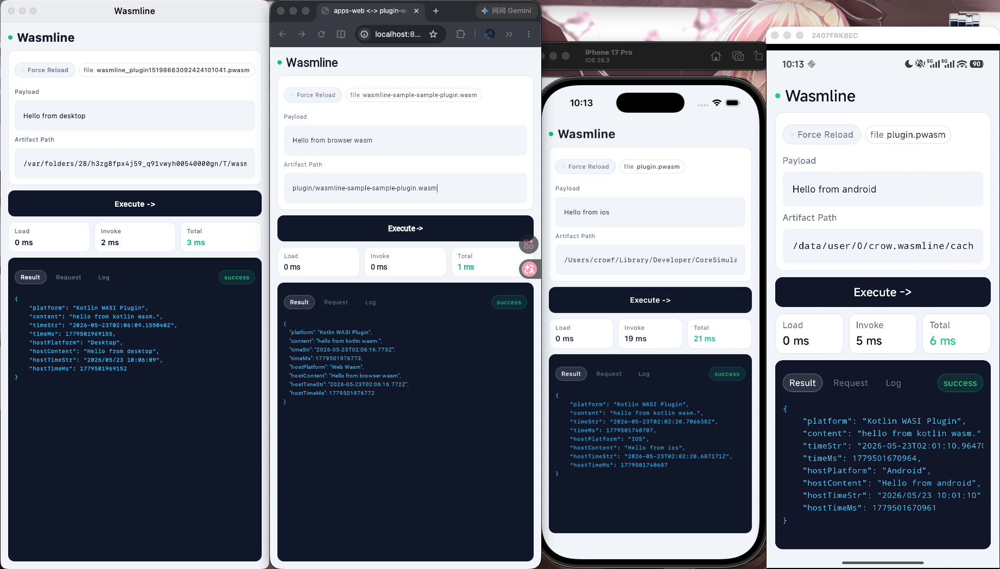
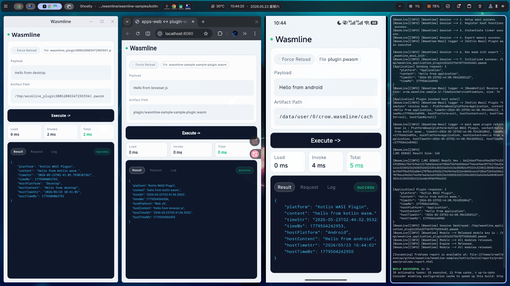
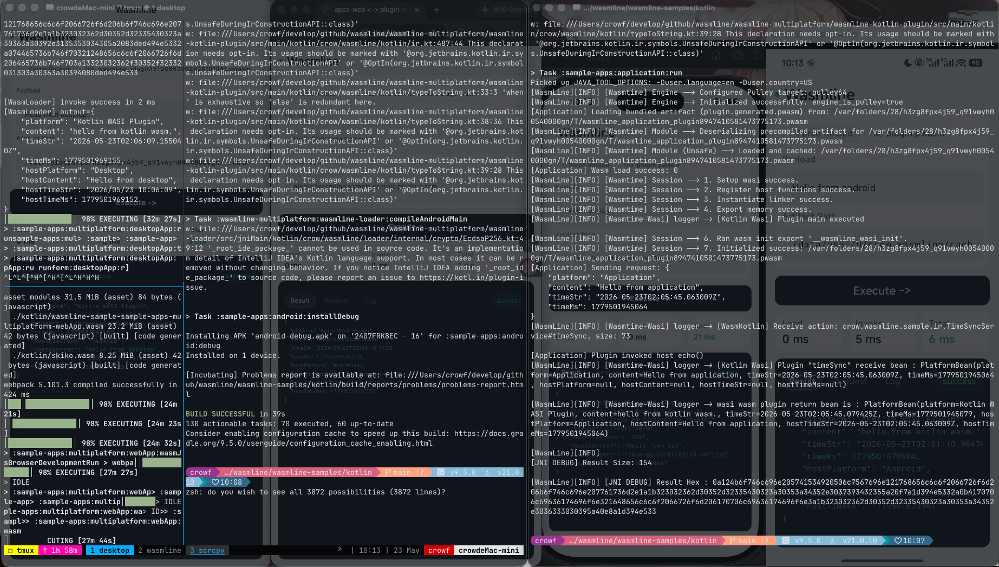
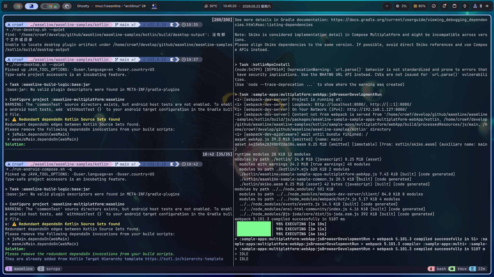
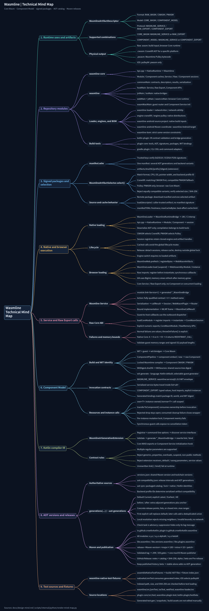

<div align="center">

<!-- Logo asset: replace src with actual path -->
<!--  -->

# wasmline

**Kotlin Multiplatform APIs for loading and calling WASI WebAssembly plugins**

[](LICENSE)
[](https://kotlinlang.org)
[](https://wasmtime.dev)
[](https://developer.android.com/build/releases/gradle-plugin)
[](https://wuya.click/wasmline)
[](https://wasi.dev)

[中文文档](README_zh.md) · [English](README.md) · [Documentation](https://wuya.click/wasmline)

</div>

---

Wasmline is a Kotlin Multiplatform library for loading and calling WASI-compliant WebAssembly plugins in Android, iOS, Desktop, and Web applications. Native execution uses the Wasmtime fork distributed by Wasmline; browser execution uses the platform WebAssembly API.

<table>
  <tr>
    <th align="center">macOS — Apps</th>
    <th align="center">Arch Linux — Apps</th>
  </tr>
  <tr>
    <td align="center">
      
      <br><em>Desktop · iOS · Android · Terminal · Web (Wasm)</em>
    </td>
    <td align="center">
      
      <br><em>Desktop · Android · Terminal · Web (JS)</em>
    </td>
  </tr>
  <tr>
    <th align="center">macOS — Build Terminals</th>
    <th align="center">Arch Linux — Build Terminals</th>
  </tr>
  <tr>
    <td align="center">
      
      <br><em>Build commands: Desktop · iOS · Android · Web (Wasm)</em>
    </td>
    <td align="center">
      
      <br><em>Build commands: Desktop · Android · Web (JS)</em>
    </td>
  </tr>
</table>

## Sample

**Define the service contract (`commonMain`):**

```kotlin
// shared/src/commonMain/kotlin/com/example/EchoService.kt
import crow.wasmline.WasmlineService

interface EchoService : WasmlineService {
    fun echo(message: String): String
}
```

**Register the implementation in the plugin (`wasmWasiMain`):**

```kotlin
// plugin/src/wasmWasiMain/kotlin/Main.kt
import crow.wasmline.Wasmline
import crow.wasmline.bind

fun main() {
    Wasmline.get().bind(object : EchoService {
        override fun echo(message: String): String {
            return "Response from WASI plugin: $message"
        }
    })
}
```

**Load the plugin and invoke services from the host:**

```kotlin
import crow.wasmline.WasmlineConfig
import crow.wasmline.WasmlineLoadResult
import crow.wasmline.link
import crow.wasmline.loader.WasmlineLoader
import crow.wasmline.loader.WasmlineLoadOptions
import crow.wasmline.loader.WasmlineTrustedKeySet
import crow.wasmline.network.ktor.KtorNetworkClient

suspend fun main() {
    // Local paths and remote URLs are both supported — http(s):// loads the remote manifest
    val module = when (val result = WasmlineLoader.load(
        source = "https://example.com/plugin/manifest.wlm",
        options = WasmlineLoadOptions(
            runtimeConfig = WasmlineConfig(),
            networkClient = KtorNetworkClient(),
            trustedKeys = WasmlineTrustedKeySet.Builder()
                .addHex(
                    algorithm = "Ed25519",
                    keyId = "release",
                    publicKeyHex = "5a778289bee0c57b05a1c48c8ef312da6ce8e4e4f13fc1a2e8e5aa4cde7ae0db",
                )
                .build(),
        ),
    )) {
        is WasmlineLoadResult.Success -> result.wasmline
        is WasmlineLoadResult.Failure -> error(result.failure.message)
    }

    val response = module.link<EchoService>().echo("ping")
    module.close()
}
```

For a remote artifact, the loader streams bytes into the cache, verifies the SHA-256 digest, then publishes the file at its digest path. Set `WasmlineLoadOptions.maxCacheBytes` to change the default capacity of 512 MiB.

`WasmlineLoader.load` is a suspending API. Local artifacts and local manifests do not require a network adapter. A remote manifest needs `wasmline-network-ktor`, `wasmline-network-okhttp`, or a custom resolver only when its fresh manifest or selected artifact is missing from the configured cache. The runtime never hardcodes an HTTP engine.

Each API has a separate role: `WasmlineLoader` resolves, verifies, selects, and loads artifacts; `WasmlineRuntime` provides process-wide preload, engine warm-up, runtime information, and shutdown; each loaded `Wasmline` is an independently closeable artifact handle. Loading is lazy, so applications do not need an explicit runtime initialization call before `WasmlineLoader.load()`.

Repeated loads of the same artifact have independent handles and service bindings; closing one does not close another. `close()` is idempotent. A handle reuses its `CoreWasmModule` facade, closes its sessions, and updates their `isClosed` state when it closes. Closing a session releases its registration without waiting for the module to close.

> [!NOTE]
> `link<T>()` and `bind(impl)` are rewrite targets of the Kotlin IR compiler plugin. If `wasmline-kotlin-plugin` is not applied to the compilation unit, these calls fail at runtime with an error explaining that the compiler plugin did not rewrite them.

## Package and AOT Compatibility

Declare the targets and AOT generations to compile. Omitting `aotCompatibility`
compiles the generation of the Wasmline build-tool version:

```kotlin
import crow.wasmline.gradle.WasmtimeTarget
import crow.wasmline.plugin.core.aot.AotGenerations

wasmline {
    wasmtime {
        aotCompatibility {
            generations(AotGenerations.Current)
        }
        targets = listOf(
            WasmtimeTarget.PULLEY_64,
            WasmtimeTarget.X86_64_LINUX,
            WasmtimeTarget.X86_64_WINDOWS,
        )
        autoDownload.set(true)
    }
}
```

`AotGenerations` also provides `Latest`, `Earliest`, `All`, windowed forms such as
`Current(before = 1, after = 1)`, and concrete version selection with
`generations(version)`, `generations(versions = listOf(...))`, or
`generations(min = ..., max = ...)`.

Selection rules, the packaged catalog fields, and the compatibility check are
documented in
[Wasmtime Download and AOT](<fumadocs/content/docs/(reference)/(repository-development)/(plugin)/wasmtime-download.mdx>).

The package stores artifacts by SHA-256 and keeps one manifest for every
selected generation:

```text
{pluginId}-{version}/
├── manifest.wlm
├── artifacts/sha256/{prefix}/{digest}.wasm|cwasm|pwasm
└── debug/
    ├── manifest.json
    ├── aot-build-record.json
    └── artifact-index.json
```

## Execution Models and Call Results

Wasmline supports four explicit host-side invocation paths:

| Execution model   | Invocation protocol | Input                                                                                     | Result                                            |
| ----------------- | ------------------- | ----------------------------------------------------------------------------------------- | ------------------------------------------------- |
| `CORE_WASM`       | `WASMLINE_SERVICE`  | action name and byte payload                                                              | `WasmlineCallResult<ByteArray>`                   |
| `CORE_WASM`       | `RAW_EXPORT`        | `CoreWasmModule`/`CoreWasmSession` numeric values, synchronous imports, and linear memory | `WasmlineCallResult<List<RawValue>>`              |
| `COMPONENT_MODEL` | `WASMLINE_SERVICE`  | action name and byte payload through `wasmline.wit`                                       | `WasmlineCallResult<ByteArray>`                   |
| `COMPONENT_MODEL` | `COMPONENT_EXPORT`  | declared Component Model values                                                           | `WasmlineCallResult<WasmlineComponentCallResult>` |

The runtime side of the Component Model path loads an already compiled component
binary. Optional plugin build steps can generate bindings and create that
binary from WIT through the Gradle plugin or the CLI; `wasmline-plugin-core` is
an internal module embedded in both tools, not a published artifact. The loader
itself does not run those tools. `contractMetadata` describes the
call contract when needed; it is not a WIT compiler input. See the
[Component Service Protocol](<fumadocs/content/docs/(reference)/(repository-development)/(plugin)/component-service.mdx>).

The browser runtime supports both Core Service and Core Raw Export paths. Web
uses raw `.wasm`, `WebAssembly.Module`/`WebAssembly.Instance`, synchronous
imports, and checked linear memory; native uses the Wasmtime bridge with
`.cwasm`/`.pwasm` AOT artifacts. Component Model typed calls remain native-only.

For `RAW_EXPORT`, load a `CoreWasmModule`, register synchronous `RawImport`
handlers before `instantiate()`, invoke `RawValue` exports, and use
`RawMemory` for bulk data. `WasmlineWeb.registerBytes()` is the browser path
for embedded `.wasm`; native selection remains AOT-only. Signed packages store
export signatures, imports, memory, and required features in
`runtimeContract.rawAbi`, not in free-form `contractMetadata` entries.

Core Wasmline calls return results instead of using exceptions for normal call failures:

```kotlin
import crow.wasmline.callResult
import crow.wasmline.invocation.WasmlineCallResult
import crow.wasmline.invocation.WasmlineErrorCode

when (val result = module.callResult("echo", payload)) {
    is WasmlineCallResult.Success -> usePayload(result.value)
    is WasmlineCallResult.Failure -> {
        if (result.failure.code == WasmlineErrorCode.ACTION_NOT_BOUND) {
            log("The plugin did not bind this action.")
        }
        log(result.failure.message)
    }
}
```

An unbound action returns `ACTION_NOT_BOUND`. It does not return an empty payload and does not crash the host. The same result-first rule applies to unknown actions, invalid payloads, traps, and handler failures. `throwOnFailure()` is an explicit adapter for code that chooses exception-style handling; it is not used by the result API by default.

`WasmlineFailure` is returned by result-based APIs for non-throwing failures,
`WasmlineException` is reserved for explicit throwing adapters, and
`WasmlineLoadFailure` describes failures before module creation. The
`failure` property is the only field that contains failure details in result
APIs.

The `WASMLINE_SERVICE` response frame starts with the four-byte `WLMF` magic marker and a one-byte `frameVersion` whose current value is `1`. The magic marker identifies the frame format; it is not a security check. `frameVersion` identifies the response byte layout; it is not a Wasmtime, Kotlin, framework, or business API version. Raw Export and Component Model calls do not use this Core response frame.

The decoder rejects truncated frames and invalid UTF-8 messages with `RESPONSE_MALFORMED`. Legacy unframed responses remain supported: fewer than four bytes matching the `WLMF` prefix are preserved as payload; the full marker without a complete header is a malformed frame.

Load through `manifest.wlm` when the package is available. The Loader verifies the package and
copies its execution model, invocation protocol, target identity, artifact
format, and AOT compatibility profile into the selected descriptor. A direct,
caller-trusted AOT descriptor must provide all of those fields explicitly; a
path such as `component.cwasm` is not enough to prove compatibility.

## Platform Support

| Platform                        | Architecture      | Artifact Support    | Loading  |
| ------------------------------- | ----------------- | ------------------- | -------- |
| Android                         | v8a, x86_64       | `.cwasm` / `.pwasm` | wasmtime |
| Android                         | v7a, x86          | `.pwasm`            | wasmtime |
| iOS                             | arm64             | `.pwasm`            | wasmtime |
| macOS                           | arm64             | `.cwasm` / `.pwasm` | wasmtime |
| Linux                           | x86_64            | `.cwasm` / `.pwasm` | wasmtime |
| Windows                         | x86_64            | `.cwasm` / `.pwasm` | wasmtime |
| Web (Kotlin/JS · Kotlin/WasmJS) | Browser JS engine | `.wasm`             | web      |

Native selection uses the AOT compatibility profile IDs reported by the linked
engine. It does not infer compatibility from a Maven version or filename.

## Installation

> [!WARNING]
> The minimum required Kotlin version is **2.4.0**.
>
> Earlier Kotlin/Native compilers may reject the published KLIB ABI; newer
> compiler versions require separate validation of the runtime artifacts and
> compiler plugin.

### Apply the Gradle plugin

```kotlin
// settings.gradle.kts
pluginManagement {
    repositories {
        google()
        mavenCentral()
        gradlePluginPortal()
    }
}

// build.gradle.kts
plugins {
    id("io.github.crowforkotlin.wasmline") version "1.0.0-beta1"
}
```

The plugin registers the packaging tasks and applies `wasmline-kotlin-plugin`,
which rewrites `link<T>()` and `bind(impl)`.

### Add runtime dependencies

Use the BOM on JVM and Android so the runtime, Loader, network adapter, and
engine resolve to one strict Wasmline version:

```kotlin
dependencies {
    implementation(platform("io.github.crowforkotlin:wasmline-bom:1.0.0-beta1"))
    implementation("io.github.crowforkotlin:wasmline-loader")
    implementation("io.github.crowforkotlin:wasmline-network-ktor")
    implementation("io.github.crowforkotlin:wasmline-engine-cranelift")
}
```

Kotlin Multiplatform source sets should use one shared version variable for all
Wasmline coordinates; engine modules are not versioned independently.

See [Installation](fumadocs/content/docs/installation.mdx) for the full module
table and per-platform setup.

## Commands

### Plugin packaging tasks

Run in a project that applies `id("io.github.crowforkotlin.wasmline")`:

```bash
./gradlew wasmlineAssembleDebug     # debug package for local testing
./gradlew wasmlineAssembleRelease   # release package for distribution
./gradlew wasmlineServerDeploy      # build and serve the configured package
```

`wasmlineServerDeploy` serves the `DEBUG` variant at `http://localhost:8080` and
binds to `127.0.0.1` by default, so only the local host can reach it. Requests
resolve inside the served package directory only: `..` segments, absolute
paths, and symlinks that leave the directory return 404. Set `server.host` to a
specific interface address when another machine must download the package.
Select another variant with a typed value:

```kotlin
import crow.wasmline.gradle.WasmlineBuildVariant

wasmline {
    server {
        deployVariant = WasmlineBuildVariant.RELEASE
    }
}
```

### Repository build tasks

Run from the repository root. Each command uses the Gradle wrapper of the
project it builds:

```bash
./gradlew assemble                                            # modules and Android AARs
./gradlew :wasmline:jvmTest                                   # JVM tests
(cd wasmline-plugin-test && ./gradlew jvmTest)                # plugin integration tests
./gradlew :wasmline:jsBrowserProductionLibraryDistribution    # JS distribution
./gradlew :wasmline:wasmJsBrowserProductionLibraryDistribution
./gradlew :wasmline:iosArm64Binaries :wasmline:iosSimulatorArm64Binaries   # macOS host
(cd samples/multiplatform-app && ./gradlew :sample-apps:multiplatform:desktopApp:packageDistributionForCurrentOS)
```

### Sample applications

```bash
(cd samples/minimal-service && ./gradlew run)                  # minimal service
(cd samples/minimal-raw-export && ./gradlew run)               # minimal raw export
(cd samples/multiplatform-app && ./gradlew :sample-apps:multiplatform:desktopApp:run)
(cd samples/multiplatform-app && ./gradlew :sample-apps:native:runKotlinNativeSample)
```

### Release

`./scripts/release.sh expected-tag` prints the tag for the current manifest.
Publication runs only for a release tag; pushing to `main` never publishes.
See [Releasing](<fumadocs/content/docs/(reference)/(repository-development)/releasing.mdx>)
for the tag format, publication checks, credentials, and artifact verification,
and [Gradle plugin task reference](<fumadocs/content/docs/(reference)/(repository-development)/(plugin)/gradle-plugin.mdx>)
for the complete task set.

## Architecture Diagram



## License

Wasmline is distributed under the **Apache License, Version 2.0**. See [LICENSE](LICENSE) for the complete license text.
