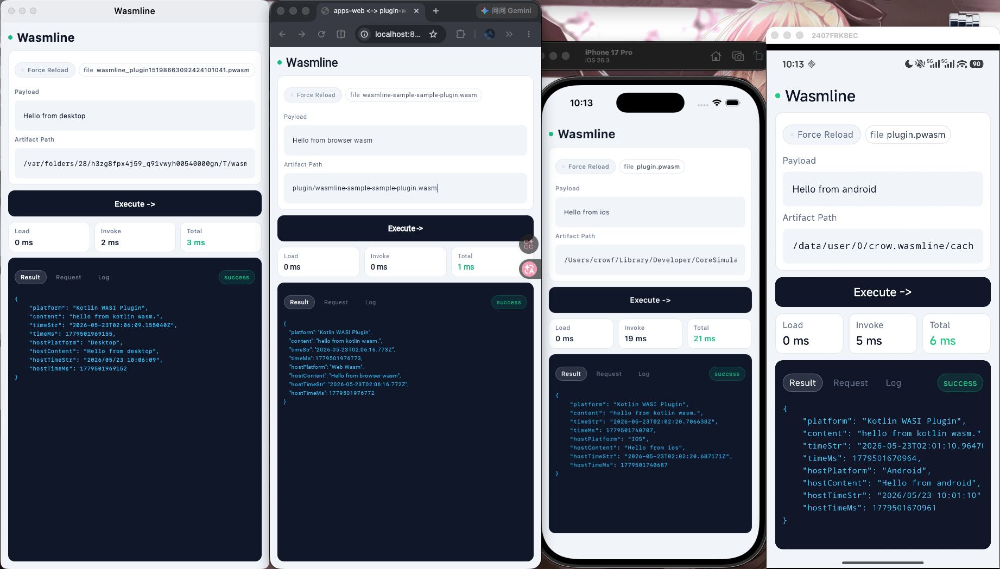
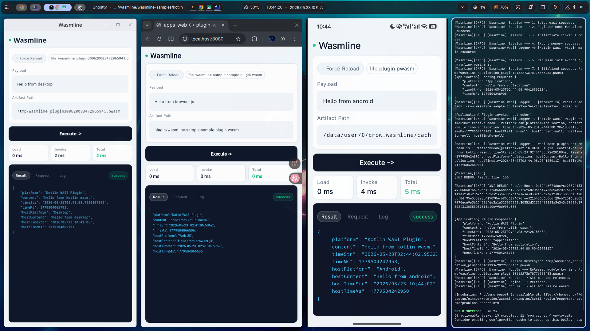
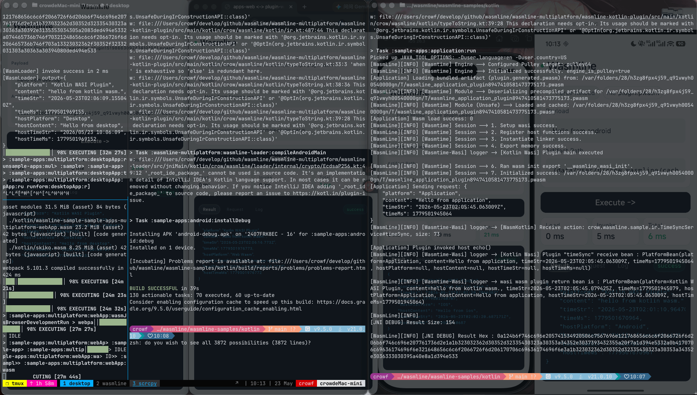
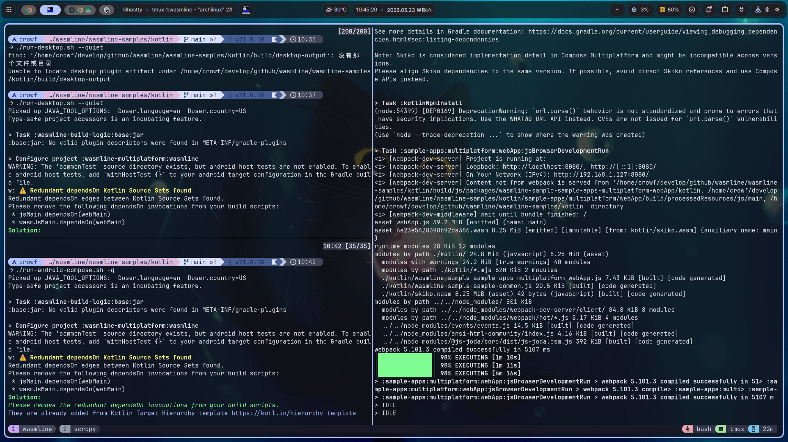

<div align="center">

<!-- Logo asset: replace src with actual path -->
<!--  -->

# wasmline

**Kotlin Multiplatform APIs for loading and calling WASI WebAssembly plugins**

[](LICENSE)
[](https://kotlinlang.org)
[](https://wasmtime.dev)
[](https://developer.android.com/build/releases/gradle-plugin)
[](https://wuya.click/wasmline)
[](https://wasi.dev)

[中文文档](README_zh.md) · [English](README.md) · [Documentation](https://wuya.click/wasmline)

</div>

---

Wasmline is a Kotlin Multiplatform library for loading and calling WASI-compliant WebAssembly plugins in Android, iOS, Desktop, and Web applications. Native execution uses the Wasmtime fork distributed by Wasmline; browser execution uses the platform WebAssembly API.

<table>
  <tr>
    <th align="center">macOS — Apps</th>
    <th align="center">Arch Linux — Apps</th>
  </tr>
  <tr>
    <td align="center">
      
      <br><em>Desktop · iOS · Android · Terminal · Web (Wasm)</em>
    </td>
    <td align="center">
      
      <br><em>Desktop · Android · Terminal · Web (JS)</em>
    </td>
  </tr>
  <tr>
    <th align="center">macOS — Build Terminals</th>
    <th align="center">Arch Linux — Build Terminals</th>
  </tr>
  <tr>
    <td align="center">
      
      <br><em>Build commands: Desktop · iOS · Android · Web (Wasm)</em>
    </td>
    <td align="center">
      
      <br><em>Build commands: Desktop · Android · Web (JS)</em>
    </td>
  </tr>
</table>

## Sample

**Define the service contract (`commonMain`):**

```kotlin
// shared/src/commonMain/kotlin/com/example/EchoService.kt
import crow.wasmline.WasmlineService

interface EchoService : WasmlineService {
    fun echo(message: String): String
}
```

**Register the implementation in the plugin (`wasmWasiMain`):**

```kotlin
// plugin/src/wasmWasiMain/kotlin/Main.kt
import crow.wasmline.Wasmline
import crow.wasmline.bind

fun main() {
    Wasmline.get().bind(object : EchoService {
        override fun echo(message: String): String {
            return "Response from WASI plugin: $message"
        }
    })
}
```

**Load the plugin and invoke services from the host:**

```kotlin
import crow.wasmline.WasmlineConfig
import crow.wasmline.WasmlineLoadResult
import crow.wasmline.link
import crow.wasmline.loader.WasmlineLoader
import crow.wasmline.loader.WasmlineLoadOptions
import crow.wasmline.loader.WasmlineTrustedKeySet
import crow.wasmline.network.ktor.KtorNetworkClient

suspend fun main() {
    // Local paths and remote URLs are both supported — http(s):// loads the remote manifest
    val module = when (val result = WasmlineLoader.load(
        source = "https://example.com/plugin/manifest.wlm",
        options = WasmlineLoadOptions(
            runtimeConfig = WasmlineConfig(),
            networkClient = KtorNetworkClient(),
            trustedKeys = WasmlineTrustedKeySet.Builder()
                .addHex(
                    algorithm = "Ed25519",
                    keyId = "release",
                    publicKeyHex = "5a778289bee0c57b05a1c48c8ef312da6ce8e4e4f13fc1a2e8e5aa4cde7ae0db",
                )
                .build(),
        ),
    )) {
        is WasmlineLoadResult.Success -> result.wasmline
        is WasmlineLoadResult.Failure -> error(result.failure.message)
    }

    val response = module.link<EchoService>().echo("ping")
    module.close()
}
```

For a remote artifact, the loader streams bytes into the cache, verifies the SHA-256 digest, then publishes the file at its digest path. Set `WasmlineLoadOptions.maxCacheBytes` to change the default capacity of 512 MiB.

`WasmlineLoader.load` is a suspending API. Local artifacts and local manifests do not require a network adapter. A remote manifest needs `wasmline-network-ktor`, `wasmline-network-okhttp`, or a custom resolver only when its fresh manifest or selected artifact is missing from the configured cache. The runtime never hardcodes an HTTP engine.

Each API has a separate role: `WasmlineLoader` resolves, verifies, selects, and loads artifacts; `WasmlineRuntime` provides process-wide preload, engine warm-up, runtime information, and shutdown; each loaded `Wasmline` is an independently closeable artifact handle. Loading is lazy, so applications do not need an explicit runtime initialization call before `WasmlineLoader.load()`.

Repeated loads of the same artifact have independent handles and service bindings; closing one does not close another. `close()` is idempotent. A handle reuses its `CoreWasmModule` facade, closes its sessions, and updates their `isClosed` state when it closes. Closing a session releases its registration without waiting for the module to close.

> [!NOTE]
> `link<T>()` and `bind(impl)` are rewrite targets of the Kotlin IR compiler plugin. If `wasmline-kotlin-plugin` is not applied to the compilation unit, these calls fail at runtime with an error explaining that the compiler plugin did not rewrite them.

## Package and AOT Compatibility

A plugin release uses one `manifest.wlm` for every configured AOT compatibility
generation and physical target. Plugin authors select Wasmline release
generations; the packaged local catalog resolves immutable, backend-specific
profile IDs.

```kotlin
import crow.wasmline.gradle.WasmtimeTarget
import crow.wasmline.plugin.core.aot.AotGenerations

wasmline {
    wasmtime {
        // Omit `aotCompatibility` to compile the current generation only.
        aotCompatibility {
            generations(AotGenerations.Current)
        }
        targets = listOf(
            WasmtimeTarget.PULLEY_64,
            WasmtimeTarget.X86_64_LINUX,
            WasmtimeTarget.X86_64_WINDOWS,
        )
        autoDownload.set(true)
    }
}
```

Omitting the block, leaving it empty, or only setting
`suppressCompatibilityWarning` selects the generation that contains the
currently introduced Wasmline build-tool version:

```kotlin
wasmline {
    wasmtime {
        // No `aotCompatibility` call: compile the current generation only.
    }
}
```

Typed strategies and concrete version selections can be combined in one block;
the first explicit call replaces the implicit current default and every later
call is a union:

```kotlin
wasmline {
    wasmtime {
        aotCompatibility {
            generations(AotGenerations.Current(before = 1))
            generations(AotGenerations.Latest)
            generations(AotGenerations.Earliest(after = 1))
            generations(AotGenerations.Versions(min = "1.0.0", max = "1.0.1"))
            generations(versions = listOf("1.0.0", "1.0.1"))
            generations(min = "1.0.0", max = "1.0.1")
        }
    }
}
```

`AotGenerations.Current`, `Latest`, `Earliest`, and `All` each select one
strategy, and `Current(before = 1, after = 1)`, `Latest(before = 1)`, and
`Earliest(after = 1)` add adjacent AOT generations. The counts are additional
neighbors: the anchor generation is always included, so
`Current(before = 1, after = 1)` covers three generations when both neighbors
exist locally. Windows count AOT generations, not Maven release versions, and a
requested neighbor that does not exist locally fails the build instead of being
clipped. `All` is opt-in and may compile every generation retained in the
packaged catalog:

```kotlin
wasmline {
    wasmtime {
        aotCompatibility {
            generations(AotGenerations.All)
        }
    }
}
```

`generations(version)` selects the generation containing one concrete `x.y.z`
Wasmline version, `generations(versions = listOf(...))` selects a non-empty
collection of concrete versions, and `generations(min = ..., max = ...)`
selects the closed interval between two concrete versions. The typed
`AotGenerations.Versions` form is equivalent to those overloads:
`Versions(version)`, `Versions(versions)`, and `Versions(min, max)`. The string
inputs are always concrete versions; there is no symbolic version string, and
`from`/`through` overloads do not exist. `Latest` is the newest generation
retained locally, `Earliest` is the oldest, and `Current` anchors on the
build-tool release version, so `Current` and `Latest` coincide while the
packaged catalog retains no newer generation. The first explicit call replaces
the implicit current default and later calls add their generations to the
union. Duplicate generations and reused backend profiles are deduplicated, so
several versions from one generation compile once. Selection is resolved
entirely from the packaged local catalog and never reads the network. Every
concrete version must lie inside the locally supported
`minimumSupportedWasmlineVersion`..`currentWasmlineVersion` interval, and
out-of-range, inverted, or unavailable input fails the build instead of being
clipped. A project with a WASI assemble graph fails at configuration time with
`[WLAOT100]`; AOT and check task actions otherwise reject the selection before
downloading compilers or signing a package. The public input is a Wasmline
release version; Wasmtime distribution versions and profile digests are internal
catalog and diagnostic values.

After a successful assemble, `wasmlineCheckAotCompatibility` compares the local
selection with the latest stable catalog and writes a report to
`build/reports/wasmline/aot-compatibility-check.json`. The task emits a warning
even when the generation gap is zero. Set
`suppressCompatibilityWarning.set(true)` only after reviewing the report; this
suppresses the log message and leaves the check and report enabled. Web raw
`.wasm` is outside this native AOT check.

The package stores artifacts by SHA-256:

```text
{pluginId}-{version}/
├── manifest.wlm
├── artifacts/sha256/{prefix}/{digest}.wasm|cwasm|pwasm
└── debug/
    ├── manifest.json
    ├── aot-build-record.json
    └── artifact-index.json
```

Core Web `.wasm` is generated and stored once; it is not repeated for every
Wasmtime version. Native CWASM and PWASM variants are compiled only for profiles
with the same backend. The offline ZIP contains every artifact selected for the
package. Remote loading fetches the manifest and one selected artifact, not the
ZIP or unrelated targets.

Pulley selects `pulley32` or `pulley64` by pointer width. Cranelift requires an
exact profile, operating system, architecture, pointer width, and CPU feature
match. It may use PWASM when no compatible CWASM exists and the runtime
reports a matching Pulley profile and support for PWASM. Artifact download or
digest failure does not trigger fallback.

Compiler archives are catalog-locked and cached by digest under
`~/.wasmline/toolchains/wasmtime/compiler-assets/sha256/`. Builds do not accept
an arbitrary local compiler executable.

## Execution Models and Call Results

Wasmline supports four explicit host-side invocation paths:

| Execution model   | Invocation protocol | Input                                                                                     | Result                                            |
| ----------------- | ------------------- | ----------------------------------------------------------------------------------------- | ------------------------------------------------- |
| `CORE_WASM`       | `WASMLINE_SERVICE`  | action name and byte payload                                                              | `WasmlineCallResult<ByteArray>`                   |
| `CORE_WASM`       | `RAW_EXPORT`        | `CoreWasmModule`/`CoreWasmSession` numeric values, synchronous imports, and linear memory | `WasmlineCallResult<List<RawValue>>`              |
| `COMPONENT_MODEL` | `WASMLINE_SERVICE`  | action name and byte payload through `wasmline.wit`                                       | `WasmlineCallResult<ByteArray>`                   |
| `COMPONENT_MODEL` | `COMPONENT_EXPORT`  | declared Component Model values                                                           | `WasmlineCallResult<WasmlineComponentCallResult>` |

The runtime side of the Component Model path loads an already compiled component
binary. Optional plugin build steps can generate bindings and create that
binary from WIT through the Gradle plugin or the CLI; `wasmline-plugin-core` is
an internal module embedded in both tools, not a published artifact. The loader
itself does not run those tools. `contractMetadata` describes the
call contract when needed; it is not a WIT compiler input. See the
[Component Service Protocol](<fumadocs/content/docs/(reference)/(plugin-development)/component-service.mdx>).

The browser runtime supports both Core Service and Core Raw Export paths. Web
uses raw `.wasm`, `WebAssembly.Module`/`WebAssembly.Instance`, synchronous
imports, and checked linear memory; native uses the Wasmtime bridge with
`.cwasm`/`.pwasm` AOT artifacts. Component Model typed calls remain native-only.

For `RAW_EXPORT`, load a `CoreWasmModule`, register synchronous `RawImport`
handlers before `instantiate()`, invoke `RawValue` exports, and use
`RawMemory` for bulk data. `WasmlineWeb.registerBytes()` is the browser path
for embedded `.wasm`; native selection remains AOT-only. Signed packages store
export signatures, imports, memory, and required features in
`runtimeContract.rawAbi`, not in free-form `contractMetadata` entries.

Core Wasmline calls return results instead of using exceptions for normal call failures:

```kotlin
import crow.wasmline.callResult
import crow.wasmline.invocation.WasmlineCallResult
import crow.wasmline.invocation.WasmlineErrorCode

when (val result = module.callResult("echo", payload)) {
    is WasmlineCallResult.Success -> usePayload(result.value)
    is WasmlineCallResult.Failure -> {
        if (result.failure.code == WasmlineErrorCode.ACTION_NOT_BOUND) {
            log("The plugin did not bind this action.")
        }
        log(result.failure.message)
    }
}
```

An unbound action returns `ACTION_NOT_BOUND`. It does not return an empty payload and does not crash the host. The same result-first rule applies to unknown actions, invalid payloads, traps, and handler failures. `throwOnFailure()` is an explicit adapter for code that chooses exception-style handling; it is not used by the result API by default.

`WasmlineFailure` is returned by result-based APIs for non-throwing failures,
`WasmlineException` is reserved for explicit throwing adapters, and
`WasmlineLoadFailure` describes failures before module creation. The
`failure` property is the only field that contains failure details in result
APIs.

The `WASMLINE_SERVICE` response frame starts with the four-byte `WLMF` magic marker and a one-byte `frameVersion` whose current value is `1`. The magic marker identifies the frame format; it is not a security check. `frameVersion` identifies the response byte layout; it is not a Wasmtime, Kotlin, framework, or business API version. Raw Export and Component Model calls do not use this Core response frame.

The decoder rejects truncated frames and invalid UTF-8 messages with `RESPONSE_MALFORMED`. Legacy unframed responses remain supported: fewer than four bytes matching the `WLMF` prefix are preserved as payload; the full marker without a complete header is a malformed frame.

Load through `manifest.wlm` when the package is available. The Loader verifies the package and
copies its execution model, invocation protocol, target identity, artifact
format, and AOT compatibility profile into the selected descriptor. A direct,
caller-trusted AOT descriptor must provide all of those fields explicitly; a
path such as `component.cwasm` is not enough to prove compatibility.

## Platform Support

| Platform                        | Architecture      | Artifact Support    | Loading  |
| ------------------------------- | ----------------- | ------------------- | -------- |
| Android                         | v8a, x86_64       | `.cwasm` / `.pwasm` | wasmtime |
| Android                         | v7a, x86          | `.pwasm`            | wasmtime |
| iOS                             | arm64             | `.pwasm`            | wasmtime |
| macOS                           | arm64             | `.cwasm` / `.pwasm` | wasmtime |
| Linux                           | x86_64            | `.cwasm` / `.pwasm` | wasmtime |
| Windows                         | x86_64            | `.cwasm` / `.pwasm` | wasmtime |
| Web (Kotlin/JS · Kotlin/WasmJS) | Browser JS engine | `.wasm`             | web      |

Native selection uses the AOT compatibility profile IDs reported by the linked
engine. It does not infer compatibility from a Maven version or filename.

## Installation

> [!NOTE]
> Wasmline is currently distributed through `mavenLocal()` and is not yet
> available from Maven Central. See [Installation](fumadocs/content/docs/installation.mdx).

> [!WARNING]
> The minimum required Kotlin version is **2.4.0**.
>
> This release is built and verified with that Kotlin version. Earlier Kotlin/Native
> compilers may reject the published KLIB ABI; newer compiler versions require
> separate validation of the runtime artifacts and compiler plugin.

Use the BOM on JVM and Android so the runtime, Loader, network adapter, and
engine resolve to one strict Wasmline version:

```kotlin
dependencies {
    implementation(platform("crow.wasmline:wasmline-bom:1.0.0"))
    implementation("crow.wasmline:wasmline-loader")
    implementation("crow.wasmline:wasmline-network-ktor")
    implementation("crow.wasmline:wasmline-engine-cranelift")
}
```

Kotlin Multiplatform source sets should use one shared version variable for all
Wasmline coordinates. Engine modules are not versioned independently. Native
startup validates the Wasmline release identity and bridge ABI before loading an
AOT artifact.

## Gradle Wrapper Tasks

After applying the released Wasmline Gradle plugin, run:

```bash
# Build a debug package for local testing
./gradlew wasmlineAssembleDebug

# Build a release package for distribution
./gradlew wasmlineAssembleRelease

# Build and serve the configured package
./gradlew wasmlineServerDeploy
```

Select the package served by `wasmlineServerDeploy` with a typed value:

```kotlin
import crow.wasmline.gradle.WasmlineBuildVariant

wasmline {
    server {
        deployVariant = WasmlineBuildVariant.RELEASE
    }
}
```

The default is `DEBUG`, served at `http://localhost:8080`.
`wasmlineServerDeploy` builds and serves the package directory for the selected
variant. See the
[Gradle plugin task reference](<fumadocs/content/docs/(reference)/(plugin-development)/gradle-plugin.mdx>) for the
current task set and registration conditions.

## Release Build

Run the commands below from the repository root. Each command uses the Gradle
wrapper belonging to the project that it builds:

```bash
# Wasmline modules and Android AARs
(cd . && ./gradlew assemble)
(cd . && ./gradlew :wasmline-android:assembleDebug)
(cd . && ./gradlew :wasmline-android:assembleRelease)

# JVM verification and Gradle plugin integration tests
(cd . && ./gradlew :wasmline:jvmTest)
(cd wasmline-plugin-test && ./gradlew jvmTest)

# Web production distributions
(cd . && ./gradlew :wasmline:jsBrowserProductionLibraryDistribution)
(cd . && ./gradlew :wasmline:wasmJsBrowserProductionLibraryDistribution)

# Apple binaries (macOS host)
(cd . && ./gradlew :wasmline:iosArm64Binaries :wasmline:iosSimulatorArm64Binaries)

# Desktop distribution for the current operating system
(cd samples/multiplatform-app && ./gradlew :sample-apps:multiplatform:desktopApp:packageDistributionForCurrentOS)
```

The GitHub Actions release job builds the publishable Wasmline modules,
validates the AOT catalog, and uploads `aot-compatibility.json` with its
SHA-256 checksum. It runs only for a tag named `release-x.y.z.v`; pushes to
`main` never publish a release. Here `x.y.z` is the Wasmline Maven version and
`v` is the fixed numeric encoding of the Wasmtime runtime version.

## Architecture Diagram


## License

Wasmline is distributed under the **Apache License, Version 2.0**. See [LICENSE](LICENSE) for the complete license text.
